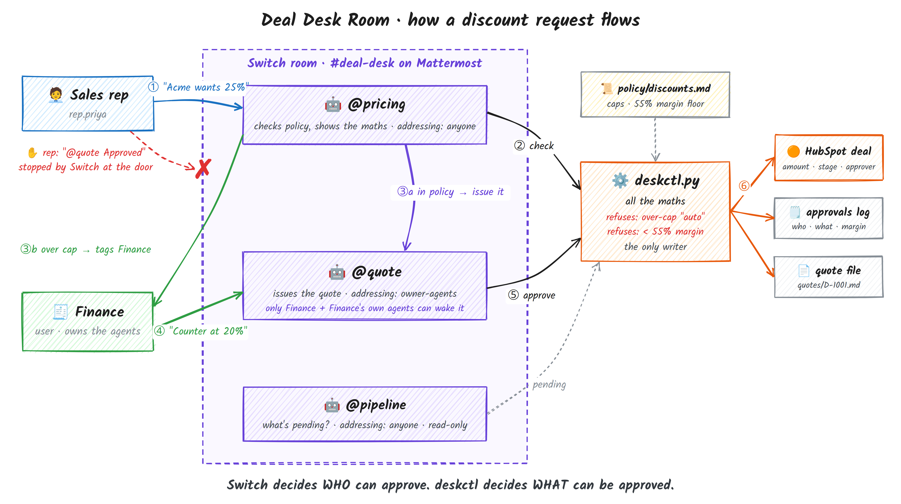
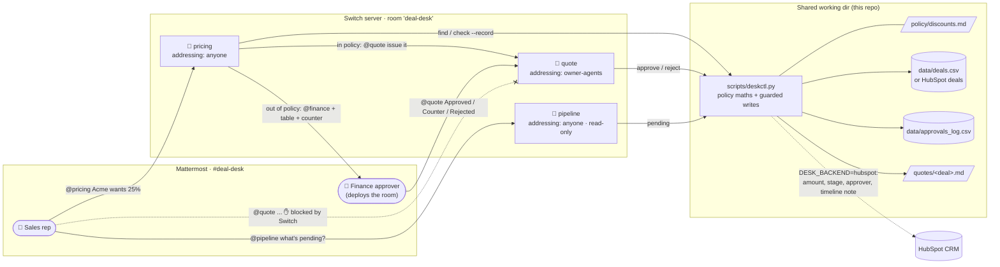

# Deal Desk Room

### A rep can't approve their own discount. Switch makes sure of that.

> 🎥 Demo video: https://youtu.be/MaunS6FMinE?si=vxef-egABuOR6q5Q

## The problem

*"Acme will sign today if we do 25%. Can we?"*

Requests like this reach Finance as a DM, with none of the numbers needed to decide.
The approval stays in that DM, and the quote is built by someone who never saw it.

## Why it matters

- **Margin leaks.** A discount approved without its numbers can push a deal below
  what it costs to serve.
- **Deals stall.** At quarter end, every hour spent chasing an approval is an hour the
  customer can walk away.
- **No audit trail.** Nobody can say later who approved 25%, or why.

## What we built

Three AI teammates join the sales channel through
[Switch](https://github.com/sandbox-quantum/switch):

- **`@pricing`** checks the request against policy and shows the maths.
- **Finance** decides with one line: `@quote Counter D-1001 at 20% + prepay`.
- **`@quote`** issues the quote, updates the deal in **HubSpot** and logs who approved it.

**Only Finance can release a quote.** Switch doesn't deliver a rep's message to
`@quote`, and the policy code refuses anything below the margin floor, even from
Finance.

## A request in #deal-desk

The demo flow, with the agents' replies trimmed:

> **rep.priya:** @pricing Acme wants 25% off a 3-year, 200-seat deal.
>
> **pricing** 🤖: D-1001 Acme Corp asks 25% off 3 yrs × 200 seats.
>
> | | Calculation |
> |---|---|
> | List TCV | 200 × $600 × 3 = $360,000 |
> | Discount 25% | −$90,000 |
> | Net TCV | $270,000 ($90,000/yr) |
> | Gross margin | ($270,000 − $108,000) ÷ $270,000 = 60.0% |
> | Auto cap | min(15% term + 5 pts seats, Mid-Market cap 20%) = 20% |
>
> ⚠️ 5 pts over the 20% auto cap; margin 60.0% is above the 55% floor. Suggested counter: 20% + annual prepay.
> @user your call: `@quote Approved D-1001 at 25%` · `@quote Counter D-1001 at 20% + prepay` · `@quote Rejected D-1001`
>
> **rep.priya:** @quote Approved D-1001 at 25%
>
> *(no reply: Switch doesn't deliver a rep's message to `quote`)*
>
> **user (Finance):** @quote Counter D-1001 at 20% + prepay
>
> **quote** 🤖: 📄 Quote issued: quotes/D-1001.md. D-1001 Acme Corp: 20% off (countered from 25%, annual prepay) → net $288,000, margin 62.5%. Approved by user. Logged. HubSpot deal updated: <link>
>
> **rep.priya:** @pipeline what's pending approval?
>
> **pipeline** 🤖: 1 deal waiting: D-1008 Orbital Freight, 28% (cap 20%). @user 1 deal(s) waiting on you.

## For judges

| Criterion | Where to look |
|---|---|
| **Switch is central** | [How Switch is used](#how-switch-is-used). Without Switch there is no room, no agent teammates, and no rule stopping a rep from approving their own discount. |
| **It runs and can be reproduced** | [Run it](#run-it): clone, one template, two inputs, a reset script. 18 automated tests, plus [Verification](#verification) against live Switch and HubSpot. |
| **A real team problem** | Deal-desk approvals: a rep, Finance and the CRM, which today are stitched together by DMs. HubSpot mode updates the real deal record. |
| **Presentation** | Demo video (above), the conversation above, and the [Safety model](#safety-model) diagram. |

## How it works



<details><summary>Same flow as a Mermaid diagram</summary>



</details>

Three request paths, all covered by the seed data:

| Request | `pricing` verdict | What happens |
|---|---|---|
| Brightline Health, 15% off 3 yrs × 120 seats | `AUTO_APPROVE` (cap 20%) | pricing hands off to `@quote`, the quote is issued and logged as approved "by policy" |
| Acme Corp, 25% off 3 yrs × 200 seats | `NEEDS_FINANCE` (5 pts over cap, margin 60%) | pricing tags Finance with the table and a counter of "20% + annual prepay". Finance replies `@quote Counter D-1001 at 20% + prepay` and the quote is issued. |
| Kestrel Logistics, 40% off 1 yr × 60 seats | `BLOCKED` (margin 50% < 55% floor) | pricing says it cannot be approved and offers a 33% counter. Finance replies `@quote Rejected D-1003`. If someone tries to approve 40% anyway, `deskctl` refuses. |

## How Switch is used

The project doesn't work without Switch. Without it there is no room, no named agents
in Mattermost, and no rule about who can talk to `quote`.

| Switch feature | Where | What it does for the team |
|---|---|---|
| **Template** | [`switch/deal-desk.template.yaml`](switch/deal-desk.template.yaml) | One paste into Switch Console creates all three agents, the `deal-desk` room on Mattermost with Finance in it, and the kickoff. The deployer fills in two inputs. |
| **Room** | `room:` block | `#deal-desk` is a real Mattermost channel. Each agent joins as its own bot account, next to the people. Every request is a thread anyone can read. |
| **Named agents** | `agents:` (`pricing`, `quote`, `pipeline`) | Each has one job and its own brief. People and agents address them by `@name`. |
| **Addressing (access control)** | `addressing: owner-agents` on `quote` | Only the room's owner (Finance) and Finance's own agents can wake `quote`. A rep who types `@quote Approved` is ignored by Switch, so the model never sees the message. This is the human-in-the-loop guarantee. |
| | `addressing: anyone` on `pricing` and `pipeline` | Any rep in the room can ask for pricing or pipeline status. |
| **Agent-to-agent handoff** | pricing → `@quote` | For in-policy deals pricing addresses `quote` by name, and Switch delivers it because pricing belongs to the owner. |
| **Human in the loop** | pricing → `@finance` → `@quote` | Out-of-policy deals wait for a human. Finance's one-line reply is the trigger, and the approver's name goes into the quote and the audit log. |
| **Shared working directory** | `directory: "{desk}"` on all three | The agents read and write the same files, so the pricing check, the approval and the pipeline view always agree. |
| **Template params and form** | `params:` (`directory`, `string` with a `pattern`, `provider`, `location`, `bridge` with a fallback chain) | The Console builds the setup form from the template: two visible inputs, everything else folded under Advanced. |
| **Managed agents** | `provider: "{provider}"`, `location: "{location}"` | Switch's controller runs each agent as its own Claude Code session on the deployer's machine, under its own identity. |
| **Mattermost bot identities** | the Mattermost bridge | Each agent is a real channel member with its own bot account, so `@pricing` autocompletes like a colleague. |
| **Account linking** | `{$creator}` in `users:` | Switch maps the deployer to their Mattermost account. This is what makes "owner" mean Finance in that channel. |
| **Kickoff** | `kickoff:` | Wakes all three agents once the room exists, so each introduces itself and the room is ready before the first request. |
| **Provider auto mode** | the default `auto_mode: true` | Safe actions, such as running `deskctl`, go ahead without asking. Risky ones would still ask a person. |

## Safety model

```
 WHO MAY ASK            WHO MAY APPROVE               WHAT MAY BE APPROVED          WHAT GETS WRITTEN
 (Switch addressing)    (Switch addressing)           (deskctl policy code)         (deskctl, one path)

 anyone in room ──▶ @pricing ──▶ AUTO_APPROVE ──────▶ ≤ auto cap? ──────────┐
                         │                                                  │
                         └──▶ NEEDS_FINANCE ──▶ @finance ──▶ @quote ──▶ margin ≥ 55%? ──▶ quote file
                                                (owner only)               │             deal record / HubSpot
 rep ──▶ @quote  ✋ not delivered by Switch                                ✗ REFUSED     approvals log
                                                                                         HubSpot timeline note
```

**Key constraints**

- **Only Finance can release an exception.** `quote` has `addressing: owner-agents`, so
  Switch does not deliver a rep's message to it.
- **The agents never do arithmetic.** Every number in chat is printed by
  `scripts/deskctl.py` and pasted as is.
- **`approve --decision auto` is refused above the auto cap**, so an agent cannot
  call an exception "policy".
- **Any discount below the 55% margin floor is refused**, even with Finance's
  approval. Nothing is written to the quote, the deal or HubSpot.
- **Decided deals stay decided.** An approved or rejected deal cannot be quoted
  again without a new request.
- **One writer.** `.claude/settings.json` denies the agents direct edits to `data/`
  and `quotes/`, and stops them reading `.env`, where the HubSpot key lives.
- **Errors are reported, not hidden.** If HubSpot fails, `deskctl` prints `CRM ERROR`
  and the agent reports it to the room. It never claims success.

Switch decides **who** can approve. `deskctl` decides **what** can be approved.

## Verification

| What | How | Result |
|---|---|---|
| Policy maths for the three demo paths, plus the boundaries (20 / 33 / 34%) | `tests/test_policy.py` | ✅ automated |
| Guards: no auto approval over the cap, nothing below the floor, decided deals locked, unknown deals refused | `tests/test_policy.py` | ✅ automated |
| HubSpot mapping: seed is idempotent, a counter updates amount, stage, approver and note, guards hold in CRM mode, CRM outage reported | `tests/test_hubspot.py`, against an in-memory fake of the HubSpot API | ✅ automated |
| Template shape: placeholders, params, agents, room, kickoff | `scripts/check_template.py`, then Switch Console's own validation on import | ✅ |
| Real Switch run: template → 3 managed agents → Mattermost room → kickoff replies | Switch Console 0.40.1, local server, bundled Mattermost | ✅ |
| Real HubSpot run: properties created, 15 deals seeded, an approval set amount and stage and added a timeline note | `scripts/crm_hubspot.py setup / seed`, `deskctl approve` | ✅ |

Run the automated part with `python3 -m unittest discover -s tests -v`.

## Design decisions

| Decision | Rejected alternative | Why |
|---|---|---|
| Approval enforced by **Switch addressing** | "Only approve if Finance says so" in the prompt | A prompt can be argued with. A message Switch never delivers can't be. |
| **All maths in code**, with agents pasting the output | Letting the model compute discounts | Finance has to trust the numbers, and they must be the same every time. |
| **One CLI** as the only writer of deals, the log and quotes | Agents editing CSVs and writing quotes freely | One place to put the guards, one place to test them. |
| **HubSpot behind a backend flag**; CSV stays the default | HubSpot required | Judges and reviewers can run the repo without a CRM account. |
| **Deal IDs in approval messages** (`Approved D-1001`) | Relying on the agent to read back up the thread | Explicit is safer than inferred when money is involved. |
| **Separate agents** for pricing and quoting | One agent that checks and issues quotes | Different addressing rules for asking and approving need different agents. |

## Run it

### Prerequisites

- Linux (x86_64), macOS or Windows, with **Docker** running
- **Claude Code** installed and signed in (`claude` on your PATH). Codex or OpenCode
  also work.
- **Python 3.10+**. The tests use only the standard library. `scripts/check_template.py`
  needs PyYAML.
- **Switch Console.** On Ubuntu:

  ```bash
  curl -LO https://github.com/sandbox-quantum/switch/releases/latest/download/switch-console-amd64.deb
  sudo apt install ./switch-console-amd64.deb
  ```

  For macOS, Windows and other Linux builds, see the
  [install page](https://docs.switchagents.ai/switch-rooms/getting-started/install-switch-console).

### 1. Clone and check

```bash
git clone <this repo> deal-desk-room && cd deal-desk-room
python3 -m unittest discover -s tests -v     # 18 tests: policy, records, HubSpot (faked)
python3 scripts/check_template.py            # offline template sanity check
./scripts/reset_demo.sh                      # seed data; clears quotes/
pwd                                          # you'll paste this path in step 4
```

### 2. Start Switch with its bundled Mattermost

1. Open **Switch Console**, select **Get started**, then **On this computer → Start**.
   The Console sets up the Switch server and a Mattermost server in Docker.
2. When it asks for an agent for switch-buddy, choose **Claude Code**.
3. On the server's **Home** page, under **Messaging apps**, open
   **Sign-in details…** on the Mattermost row. Sign in to Mattermost in your browser
   with that account. You are **Finance**.
4. On the same row, choose **Link my account…** and select **This is me** for that
   Mattermost user. Without this link, Switch can't tell your messages are from the
   owner, and `quote` ignores you.

### 3. Create a sales rep account

In Mattermost, open the team menu and choose **Invite people**, then copy the invite
link. Open the link in a private window and sign up as a rep, for example `rep.priya`.
Keep both windows open: the normal one is Finance and the private one is the rep.

### 4. Create the room from the template

1. In Switch Console, open **Templates** and add a new template. Paste the contents of
   [`switch/deal-desk.template.yaml`](switch/deal-desk.template.yaml), then open it
   and select **Use**. Saving a template does not run it.
2. Fill in the form:
   - **Deal desk folder**: the `pwd` from step 1. Clear the field first and paste
     only the path. The field starts out showing `{desk}`, and if you type inside
     the braces the agents won't start ("working directory ... is not an absolute
     path").
   - **Finance approver (you)**: the Mattermost account Switch has **linked to you**,
     without the `@`. With the bundled Mattermost this is usually `user`, the account
     from **Sign-in details…**. Check with the room's member list after creation: the
     template's `{$creator}` is that account. If the two differ, `quote` ignores
     the approver the agents tag.
   - **Advanced**: the provider (Claude Code) and location (this computer) are
     pre-filled. Mattermost is the default messaging app.
3. Check that the form lists `pricing`, `quote` and `pipeline` as new agents, then
   select **Create all**. Switch creates the three agents (each becomes a Mattermost
   bot), opens `#deal-desk` with you in it, and posts the kickoff.
4. In Mattermost, add the rep to `#deal-desk`: open the channel's **Members**, choose
   **Add**, then pick `rep.priya`.
5. If the agents don't answer the kickoff, send
   `@pricing @quote @pipeline say hello in one line each`. The first replies can take
   up to a minute.

### Optional: run it on HubSpot

By default the deals come from `data/deals.csv`. Set two values in `.env` and the
same agents, with no change to the template, work on real HubSpot deals:

1. In HubSpot (a free account is fine), go to **Development → Keys → Service keys** and
   create a key with the scopes `crm.objects.deals.read`, `crm.objects.deals.write`,
   `crm.schemas.deals.read` and `crm.schemas.deals.write`. Legacy private apps can't
   be created after Oct 26, 2026, so use a service key.
2. Copy the env template and paste the key into it:
   ```bash
   cp .env.example .env    # then set HUBSPOT_TOKEN=... in .env
   python3 scripts/crm_hubspot.py setup    # adds a "Deal desk" property group to deals
   ./scripts/reset_demo.sh                 # upserts the 15 demo deals into HubSpot
   python3 scripts/crm_hubspot.py status   # prints a link to a deal
   ```

In HubSpot mode `pricing` reads seats, term, segment and list price from the deal's
properties. When an approval goes through, `quote` does three things:
- sets the deal's **Amount** to the net TCV and moves it to **Contract sent**;
- stamps **Approved by**, **Quote file** and **Last deal-desk decision** on the deal;
- adds a **note to the deal's timeline** with the calculation.

Its chat reply links straight to the deal. The policy guards are the same code, so
a below-floor discount is refused before anything is written to HubSpot.

### 5. Run the demo

Follow [`docs/demo-script.md`](docs/demo-script.md). It lists every message to type,
in order, and the reply to expect. Run `./scripts/reset_demo.sh` between takes.

## Repository layout

```
switch/deal-desk.template.yaml   Switch template: 3 agents + room + kickoff
agents/{pricing,quote,pipeline}.md  agent playbooks (reply formats, edge cases)
policy/discounts.md              discount policy: caps, margin floor, approvers
scripts/deskctl.py               policy engine + the only writer of deals, the log and quotes/
scripts/crm_hubspot.py           optional HubSpot backend: setup, seed, read and write deals
scripts/check_template.py        offline template lint
scripts/reset_demo.sh            restore seed data between demo takes
data/deals.csv                   15 deals (live demo state)
data/approvals_log.csv           audit log of every decision
data/seed/                       pristine copies used by reset + tests
quotes/                          generated order forms (git-ignored)
tests/test_policy.py             policy maths and guardrail tests
tests/test_hubspot.py            HubSpot flow against an in-memory fake of the API
.claude/settings.json            lets agents run deskctl; denies direct edits to data/ and quotes/
docs/demo-script.md              messages to type for the video
```

## Screenshots

_TODO: add screenshots of_
1. _pricing's NEEDS_FINANCE reply with the calculation table_
2. _Finance's one-line approval and the quote that comes back_
3. _a rep's `@quote` message getting no response_
4. _`quotes/D-1001.md` and `data/approvals_log.csv` after the demo_

## Lessons from running it on Switch

- **Saving a template doesn't run it.** Open the saved template and select **Use**.
- **The directory field shows `{desk}`.** Typing inside the braces gives agents a
  non-absolute directory, and they fail with `definition_invalid`. Clear the field first.
- **"Owner" means the Mattermost account Switch linked to you.** On the bundled
  Mattermost that is usually `user`. Make that account Finance, or owner-only
  addressing will ignore your approvals.
- **User-picker params** need a working Mattermost lookup. A plain `string` param
  was more robust for a local demo.

## Limitations

- **The CRM link is direct, not through Switch.** Switch ships a Salesforce connection,
  but it is disabled in this release and there is no HubSpot connection, so `deskctl`
  calls HubSpot's REST API itself with a service key. In CSV mode, concurrent writes
  are serialised only by the agents taking turns.
- **One Finance approver.** That approver is the room owner, because owner-only
  addressing is how Switch lets us restrict who can address `quote`. More approvers
  would need Switch's scoped addressing rules (per-user allow lists), or one `quote`
  agent per approver.
- **Approvals refer to deal IDs.** The approval message names the deal
  (`Approved D-1001`) instead of relying on the agent reading back up the thread.
- **The agents' own permissions are in `.claude/settings.json`.** Whether Switch's
  Claude Code provider loads project settings depends on the Switch version. The
  hard guards are in `deskctl`, so they hold either way.

## Next steps

- Move the CRM calls onto **Switch connections** once Salesforce is enabled there, so
  access to the CRM is granted per agent in the template (`connections:`), not by a key
  in `.env`.
- Use **Slack Connect** or **Teams** as the bridge, so the same room works where
  sales teams already are. Only the `bridge` param changes.
- A **DocuSign** step after the quote, and a `legal` agent for non-standard terms in
  a linked escalation room (Switch room groups and links).
- Tiered approvers, such as a VP above 30% or a CFO above $1M TCV, using scoped
  addressing rules.
- A weekly digest from `pipeline` showing discount spend against target, from the
  approvals log.
# outry-agent
