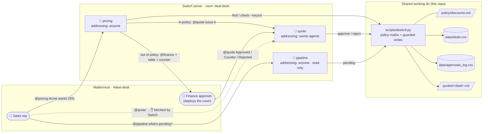

# Deal Desk Room

**A sales deal desk in one chat room: a rep asks for a discount, Switch agents check
it against policy, Finance approves exceptions in the same thread, and a quote is
issued only after approval.**

> Flip the Switch Hackathon, Track 01: Best Business Workflow
>
> 🎥 Demo video: _TODO: add link_ · 📸 Screenshots: [below](#screenshots)

## The problem

Deal-desk approvals get stuck in DMs and email. A rep pings Finance with "can we do
25% for Acme?" and Finance has to dig up the seat count, the term and the margin. The
answer goes back by DM. Whoever builds the quote never sees the conversation, and six
months later nobody can tell who approved what, or why. Every step is a hand-off
between people who don't share context.

**Deal Desk Room puts the whole loop in one shared channel.** The rep asks a named
agent. The agent prices the request against written policy and shows its arithmetic.
Finance sees the exact numbers and decides with one reply. A second agent issues the
order form and writes the audit record. Anyone in the room can follow every step, and
Switch's addressing rules make the approval step **enforced, not polite**: reps
cannot get a quote out of the `quote` agent at all.

## How it works



Three request paths, all covered by the seed data:

| Request | `pricing` verdict | What happens |
|---|---|---|
| Brightline Health, 15% off 3 yrs × 120 seats | `AUTO_APPROVE` (cap 20%) | pricing hands off to `@quote`, the quote is issued and logged as approved "by policy" |
| Acme Corp, 25% off 3 yrs × 200 seats | `NEEDS_FINANCE` (5 pts over cap, margin 60%) | pricing tags Finance with the table and a counter of "20% + annual prepay". Finance replies `@quote Counter D-1001 at 20% + prepay` and the quote is issued. |
| Kestrel Logistics, 40% off 1 yr × 60 seats | `BLOCKED` (margin 50% < 55% floor) | pricing says it cannot be approved and offers a 33% counter. Finance replies `@quote Rejected D-1003`. If someone tries to approve 40% anyway, `deskctl` refuses. |

## How Switch is used

The project doesn't work without Switch. Without it there is no room, no named agents
in Mattermost, and no rule about who can talk to `quote`.

| Switch concept | Where | What it does here |
|---|---|---|
| **Template** | [`switch/deal-desk.template.yaml`](switch/deal-desk.template.yaml) | One paste into Switch Console creates all three agents, the `deal-desk` room on Mattermost with Finance and a rep in it, and the kickoff. The deployer fills in two inputs. |
| **Room** | `room:` block | `#deal-desk` is a real Mattermost channel. Each agent joins as its own bot account, next to the people. Every request is a thread anyone can read. |
| **Named agents** | `agents:` (`pricing`, `quote`, `pipeline`) | Each has one job and its own brief. People and agents address them by `@name`. |
| **Addressing (access control)** | `addressing: owner-agents` on `quote` | Only the room's owner (Finance) and Finance's own agents can wake `quote`. A rep who types `@quote Approved` is ignored by Switch, so the model never sees the message. This is the human-in-the-loop guarantee. |
| | `addressing: anyone` on `pricing` and `pipeline` | Any rep in the room can ask for pricing or pipeline status. |
| **Agent-to-agent handoff** | pricing → `@quote` | For in-policy deals pricing addresses `quote` by name, and Switch delivers it because pricing belongs to the owner. |
| **Human in the loop** | pricing → `@finance` → `@quote` | Out-of-policy deals wait for a human. Finance's one-line reply is the trigger, and the approver's name goes into the quote and the audit log. |
| **Shared working directory** | `directory: "{desk}"` on all three | The agents read and write the same files, so the pricing check, the approval and the pipeline view always agree. |

### Why decisions are checked by code as well

The agents never do arithmetic or edit records themselves. They call
[`scripts/deskctl.py`](scripts/deskctl.py), which:

- prints the calculation table that `pricing` posts, so Finance can check each step;
- refuses `--decision auto` above the auto cap, and refuses **any** approval below the
  55% margin floor;
- writes the quote, updates `data/deals.csv` and appends `data/approvals_log.csv` in one
  step;
- is covered by `tests/test_policy.py` for all three demo scenarios and the edge cases.

Switch decides **who** can approve. `deskctl` decides **what** can be approved.

## Run it

### Prerequisites

- Linux (x86_64), macOS or Windows, with **Docker** running
- **Claude Code** installed and signed in (`claude` on your PATH). Codex or OpenCode
  also work.
- **Python 3.10+**. The tests use only the standard library. `scripts/check_template.py`
  needs PyYAML.
- **Switch Console.** On Ubuntu:

  ```bash
  curl -LO https://github.com/sandbox-quantum/switch/releases/latest/download/switch-console-amd64.deb
  sudo apt install ./switch-console-amd64.deb
  ```

  For macOS, Windows and other Linux builds, see the
  [install page](https://docs.switchagents.ai/switch-rooms/getting-started/install-switch-console).

### 1. Clone and check

```bash
git clone <this repo> deal-desk-room && cd deal-desk-room
python3 -m unittest discover -s tests -v     # 14 policy + record-keeping tests
python3 scripts/check_template.py            # offline template sanity check
./scripts/reset_demo.sh                      # seed data; clears quotes/
pwd                                          # you'll paste this path in step 4
```

### 2. Start Switch with its bundled Mattermost

1. Open **Switch Console**, select **Get started**, then **On this computer → Start**.
   The Console sets up the Switch server and a Mattermost server in Docker.
2. When it asks for an agent for switch-buddy, choose **Claude Code**.
3. On the server's **Home** page, under **Messaging apps**, open
   **Sign-in details…** on the Mattermost row. Sign in to Mattermost in your browser
   with that account. You are **Finance**.
4. On the same row, choose **Link my account…** and select **This is me** for that
   Mattermost user. Without this link, Switch can't tell your messages are from the
   owner, and `quote` ignores you.

### 3. Create a sales rep account

In Mattermost, open the team menu and choose **Invite people**, then copy the invite
link. Open the link in a private window and sign up as a rep, for example `rep.priya`.
Keep both windows open: the normal one is Finance and the private one is the rep.

### 4. Create the room from the template

1. In Switch Console, open **Templates** and add a new template. Paste the contents of
   [`switch/deal-desk.template.yaml`](switch/deal-desk.template.yaml), then open it
   and select **Use**. Saving a template does not run it.
2. Fill in the form:
   - **Deal desk folder**: the `pwd` from step 1. Clear the field first and paste
     only the path. The field starts out showing `{desk}`, and if you type inside
     the braces the agents won't start ("working directory ... is not an absolute
     path").
   - **Finance approver (you)**: your Mattermost username, without the `@`
   - **Advanced**: the provider (Claude Code) and location (this computer) are
     pre-filled. Mattermost is the default messaging app.
3. Check that the form lists `pricing`, `quote` and `pipeline` as new agents, then
   select **Create all**. Switch creates the three agents (each becomes a Mattermost
   bot), opens `#deal-desk` with you in it, and posts the kickoff.
4. In Mattermost, add the rep to `#deal-desk`: open the channel's **Members**, choose
   **Add**, then pick `rep.priya`.
5. If the agents don't answer the kickoff, send
   `@pricing @quote @pipeline say hello in one line each`. The first replies can take
   up to a minute.

### 5. Run the demo

Follow [`docs/demo-script.md`](docs/demo-script.md). It lists every message to type,
in order, and the reply to expect. Run `./scripts/reset_demo.sh` between takes.

## Repository layout

```
switch/deal-desk.template.yaml   Switch template: 3 agents + room + kickoff
agents/{pricing,quote,pipeline}.md  agent playbooks (reply formats, edge cases)
policy/discounts.md              discount policy: caps, margin floor, approvers
scripts/deskctl.py               policy engine + the only writer of data/ and quotes/
scripts/check_template.py        offline template lint
scripts/reset_demo.sh            restore seed data between demo takes
data/deals.csv                   15 deals (live demo state)
data/approvals_log.csv           audit log of every decision
data/seed/                       pristine copies used by reset + tests
quotes/                          generated order forms (git-ignored)
tests/test_policy.py             policy maths and guardrail tests
.claude/settings.json            lets agents run deskctl; denies direct edits to data/ and quotes/
docs/demo-script.md              messages to type for the video
```

## Screenshots

_TODO: add screenshots of_
1. _pricing's NEEDS_FINANCE reply with the calculation table_
2. _Finance's one-line approval and the quote that comes back_
3. _a rep's `@quote` message getting no response_
4. _`quotes/D-1001.md` and `data/approvals_log.csv` after the demo_

## Limitations

- **CSV instead of a CRM.** Deals live in `data/deals.csv`, and concurrent writes are
  serialised only by the agents taking turns.
- **One Finance approver.** That approver is the room owner, because owner-only
  addressing is how Switch lets us restrict who can address `quote`. More approvers
  would need Switch's scoped addressing rules (per-user allow lists), or one `quote`
  agent per approver.
- **Approvals refer to deal IDs.** The approval message names the deal
  (`Approved D-1001`) instead of relying on the agent reading back up the thread.
- **The agents' own permissions are in `.claude/settings.json`.** Whether Switch's
  Claude Code provider loads project settings depends on the Switch version. The
  hard guards are in `deskctl`, so they hold either way.

## Next steps

- Replace the CSV with **HubSpot or Salesforce** through Switch connections: read
  the opportunity and write the approved discount back to it.
- Use **Slack Connect** or **Teams** as the bridge, so the same room works where
  sales teams already are. Only the `bridge` param changes.
- A **DocuSign** step after the quote, and a `legal` agent for non-standard terms in
  a linked escalation room (Switch room groups and links).
- Tiered approvers, such as a VP above 30% or a CFO above $1M TCV, using scoped
  addressing rules.
- A weekly digest from `pipeline` showing discount spend against target, from the
  approvals log.
