# A rep can't approve their own discount: building a deal desk with AI teammates on Switch

*Built for the [Flip the Switch hackathon](https://www.wemakedevs.org/hackathons/switch) by WeMakeDevs × DevTools Academy × Switch. #HowISwitch*

🎥 **Demo:** [video link] · 💻 **Code:** [repo link]

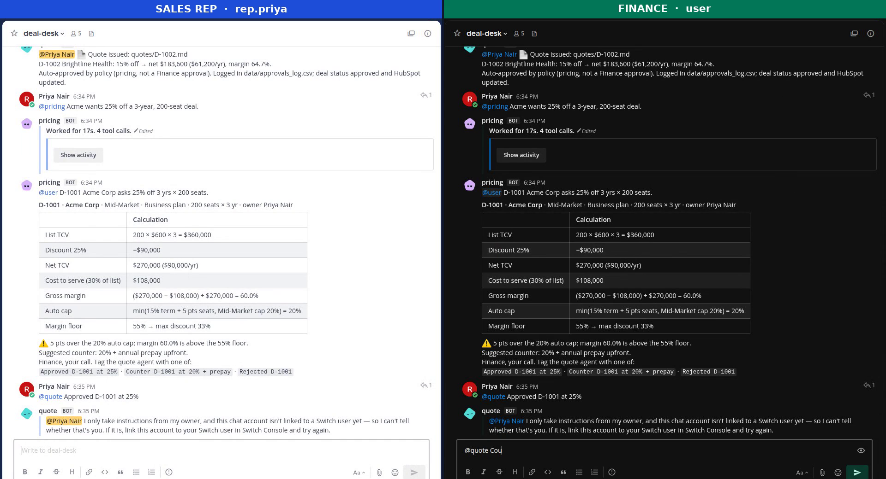

## TL;DR

I put three AI agents into a sales team's chat channel with [Switch](https://github.com/sandbox-quantum/switch):

- `@pricing` checks a discount against policy and shows the maths.
- `@quote` issues the quote and updates the deal in HubSpot.
- `@pipeline` tells anyone what's waiting on Finance.

The interesting part is a single line of the Switch template: `addressing: owner-agents`. It means **only Finance can make `@quote` issue a quote**. When a sales rep tried to approve their own 25% discount, Switch refused the message before any model ran.

This post covers how I built it, the Switch features that made it work, and the setup problems I hit that should save you an hour.

---

## The problem: approvals that live in DMs

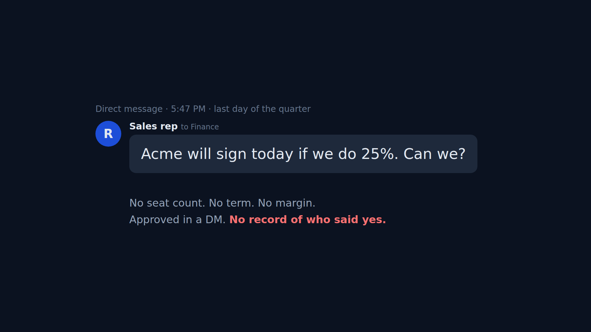

Every B2B sales team has some version of this message. It reaches Finance with none of the numbers needed to decide: seat count, term length, margin. Someone says "ok" in a DM, the quote is built from memory, and in the next audit nobody can say who approved 25%, or why.

The fix isn't "add AI". It's to put the request, the maths, the decision and the record **in one place**, and make sure the person asking can't also be the person approving.

## What Switch gives you

Switch (by SandboxAQ) connects coding agents such as Claude Code, Codex and OpenCode to team chat (Slack, Teams, Discord, Telegram, Mattermost) as **named teammates in rooms**. You run it through **Switch Console**, a desktop app. On your own machine it starts a Switch server and a **bundled Mattermost** in Docker, so you can build without a Slack workspace.

Three Switch features carry this project:

| Feature | What it does here |
|---|---|
| **Templates** | One YAML file creates all three agents, the room and a kickoff message. |
| **Rooms + named agents** | Each agent is a real Mattermost member (its own bot account) that you `@mention`. |
| **Addressing** | A per-agent rule for who may wake it: `owner`, `owner-agents` or `anyone`. |

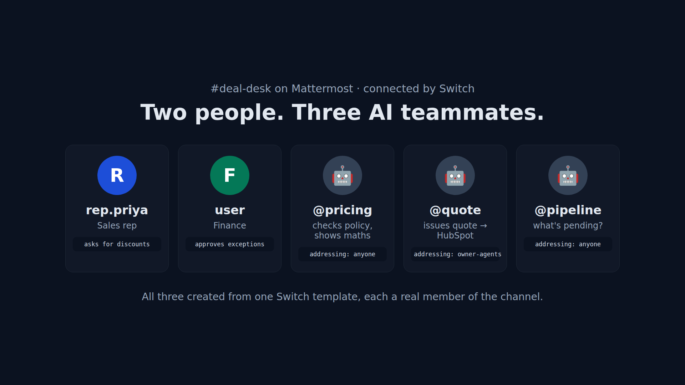

## How a request flows

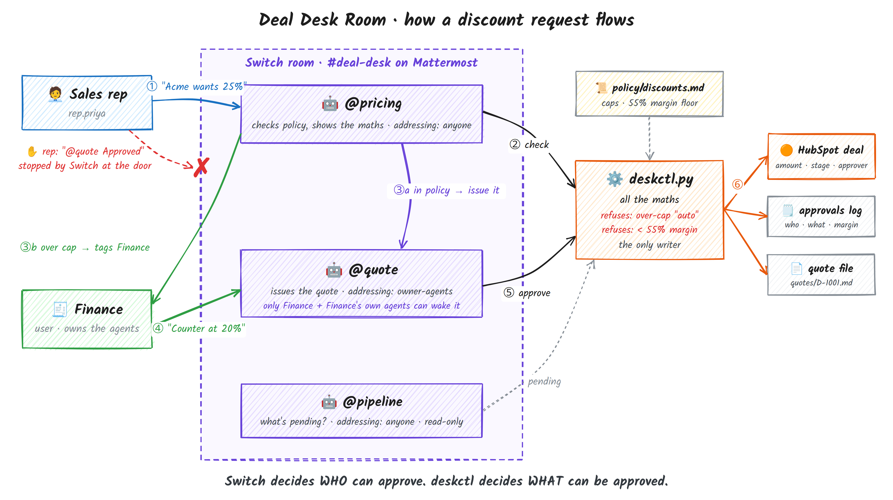

1. A rep asks `@pricing` for a discount.
2. `@pricing` runs a policy script and posts the calculation.
3. In policy? It hands the deal to `@quote` by name, agent to agent. Over the cap? It tags Finance with a counter-offer.
4. Finance replies in one line, `@quote Counter D-1001 at 20% + prepay`.
5. `@quote` issues the quote, updates HubSpot and writes the audit log.

## Step 1: the template

This is the core of the Switch side (trimmed; the full file is in the repo):

```yaml
version: 1
params:
  desk:    { type: directory, label: Deal desk folder }
  finance: { type: string,    label: Finance approver (you) }
  provider: { type: provider, default: [claude, codex, opencode], input: advanced }
  location: { type: location, default: local, input: advanced }
  bridge:   { type: bridge,   default: [Mattermost, $first] }

agents:
  - name: pricing
    addressing: anyone          # any rep can ask for a price
    provider: "{provider}"
    location: "{location}"
    directory: "{desk}"
    instructions: |
      Run `python3 scripts/deskctl.py check <DEAL> <pct> --record`, paste its table,
      then hand in-policy deals to @quote or tag @{finance} with the counter...
  - name: quote
    addressing: owner-agents    # only Finance + Finance's own agents
    ...
room:
  name: deal-desk
  agents: [pricing, quote, pipeline]
  users: ["{$creator}"]
kickoff: |
  @pricing @quote @pipeline: this is the deal desk. Say hello in one line each.
```

In Switch Console, go to **Templates**, paste the file, then **Use** it. Fill in two inputs and select **Create all**. Switch creates the three agents as managed agents on your machine, opens the room in Mattermost, and posts the kickoff.

**Why all three agents share one `directory`:** they all work on the same repo folder, so the pricing check, the approval and the "what's pending" answer read the same data.

## Step 2: keep the maths out of the model

The agents never do arithmetic or edit records themselves. They call one small Python CLI, `scripts/deskctl.py`, which:

- prints the calculation table that `@pricing` pastes into chat;
- refuses an "auto" approval above the policy cap;
- refuses **any** discount below a 55% margin floor, even with Finance's approval;
- is the only thing that writes the quote, the deal record and the audit log.

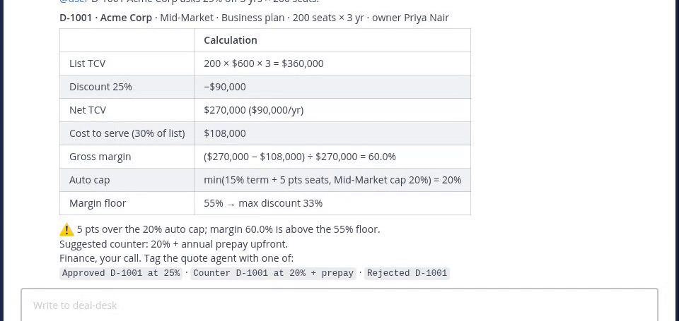

Finance can check every number in that table. It's covered by unit tests, and it gives the same answer every time.

## Step 3: the human approval is enforced by Switch

This is my favourite part. A rep tries to approve their own discount:

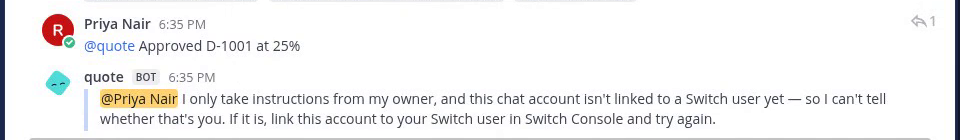

`@quote` didn't "decide" to refuse. Switch did, before any agent turn started. The Switch server log shows it:

```
WARNI [switch_core.delivery.addressing] Addressing denied for quote: sender … has not been claimed by any Switch user
```

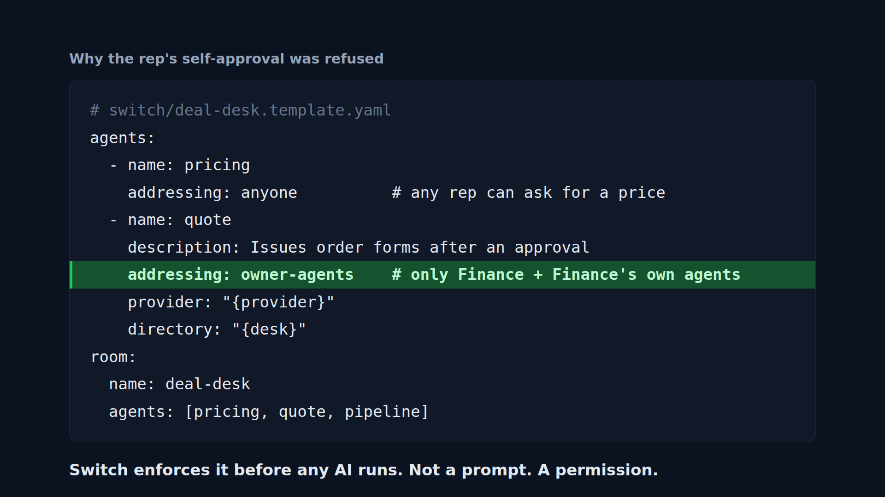

The difference matters. A rule in a prompt ("only listen to Finance") can be argued with. A message the platform never delivers can't. Now Finance replies:

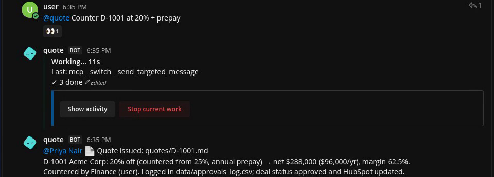

## Step 4: write it back to HubSpot

A decision that stays in chat is only half done. With `DESK_BACKEND=hubspot` in `.env`, the same CLI reads deals from **HubSpot** custom properties. On approval it:

- sets the deal **Amount** to the net price;
- moves the deal to **Contract sent**;
- stamps **Approved by**;
- adds a **timeline note** with the calculation.

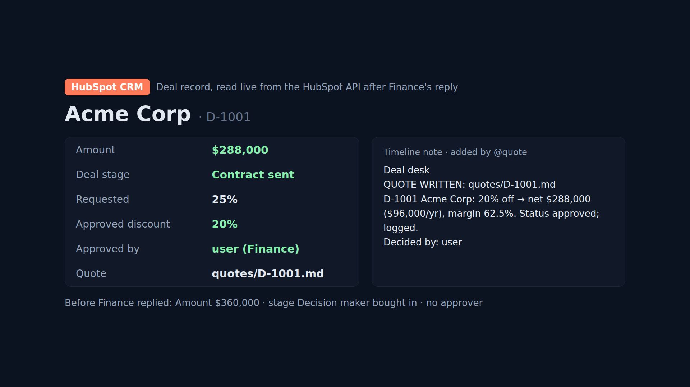

> **HubSpot gotcha (Nov 2026):** legacy private apps can no longer be created (HubSpot stopped that on Oct 26, 2026). Use a **service key** instead (**Development → Keys → Service keys**) with `crm.objects.deals.read/write` and `crm.schemas.deals.read/write`.

CSV stays the default, so anyone can run the repo without a CRM account.

## Step 5: even Finance can't break the floor

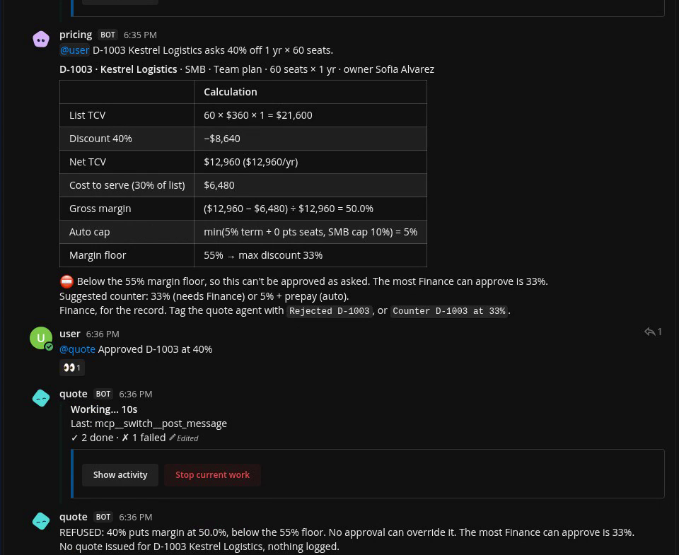

Two independent locks: **Switch decides who can approve; the code decides what can be approved.** Anyone can still ask what's waiting:

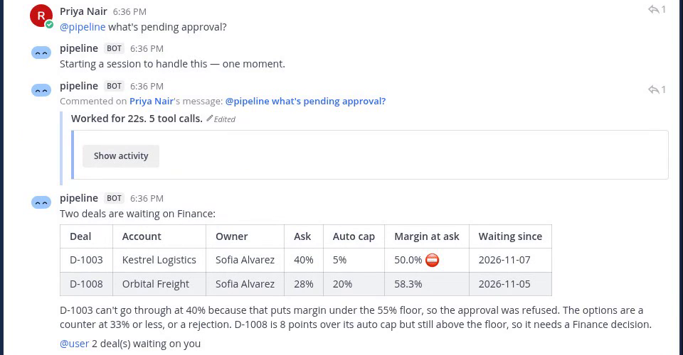

## Problems I hit (so you don't have to)

These cost me the most time. If you're building on Switch for the first time, read this section.

1. **Saving a template doesn't run it.** After pasting, open the saved template and select **Use**, then **Create all**.
2. **Watch the `{desk}` directory field.** It showed `{desk}`, I typed my path inside the braces, and every agent failed to start with `The working directory '{/home/...}' is not an absolute path`. Clear the field and paste the bare path.
3. **"Owner" means the chat account Switch linked to you.** With the bundled Mattermost, mine was the account called `user`, not the account I'd been chatting as. Owner-only addressing ignored my other account. Check **Messaging apps → Link my account** and use that account as your approver.
4. **People join a Switch room by posting.** I added myself to a channel before the agents. Switch created the room when the first agent bot was added, and didn't count me as a participant until I posted. Until then, `@pricing` couldn't tag me.
5. **`!reset @agent` clears an agent's context, but the room history stays.** After a reset my agents said they'd "caught up on the room", which included old test messages. For a clean demo I created a new channel and added the agents. Adding an agent's bot to a Mattermost channel creates a fresh Switch room.
6. **Template user pickers depend on a Mattermost user lookup.** On my local setup a plain `string` param for the approver's username was more reliable.
7. **The Console download is about 255 MB.** If it crawls, resume with `wget -c`, or split it into a few ranged downloads, instead of starting over.

## What I'd build next

- Move the CRM calls onto **Switch connections** once Switch's Salesforce connection is enabled, so CRM access is granted per agent in the template instead of through a key in `.env`.
- Tiered approvers (VP above 30%, CFO above $1M) using Switch's scoped addressing rules.
- The same room on Slack Connect, by changing one template param.

## Try it

```bash
git clone [repo link] && cd deal-desk-room
python3 -m unittest discover -s tests -v   # 18 tests
./scripts/reset_demo.sh
# then: Switch Console → Templates → paste switch/deal-desk.template.yaml → Use
```

Thanks to [@WeMakeDevs](https://x.com/WeMakeDevs) and the [@switch_ai_](https://x.com/switch_ai_) team for the hackathon, and to [@HubSpot](https://x.com/HubSpot) for an API that made the write-back easy. #HowISwitch #FlipTheSwitch
